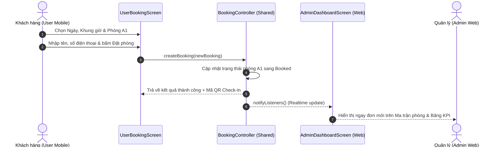

# CODEBASE MAP - GOLF BOOKING SYSTEM

Tài liệu này mô tả chi tiết bản đồ cấu trúc thư mục, trách nhiệm của từng module và luồng luân chuyển dữ liệu trong dự án.

---

## 1. Cấu trúc Thư mục Tổng quan (Architectural Tree)

```text
d:/CongViec/App/golf_booking/
├── .agents/                    # Customization Skills của Antigravity Agent
│   └── skills/                 # graphify, ponytail, taste-skill, impeccable
├── android/                    # Mã nguồn Native Android
├── ios/                        # Mã nguồn Native iOS
├── web/                        # Khung ứng dụng Web (index.html, favicon, manifest)
├── test/                       # Unit & Widget tests
│   ├── booking_flow_test.dart
│   ├── firebase_live_test.dart
│   ├── responsive_devices_test.dart
│   └── widget_test.dart
├── current_state.md            # Theo dõi trạng thái & nhật ký dự án
├── codebase_map.md             # Bản đồ kiến trúc mã nguồn
├── pubspec.yaml                # Cấu hình dependencies & assets
│
└── lib/
    ├── main.dart               # Entry point ứng dụng (khởi tạo Router & State)
    │
    ├── core/                   # TẦNG DÙNG CHUNG CỐT LÕI (CORE FOUNDATION)
    │   ├── constants/          # Hằng số (Chuỗi, thời gian, cài đặt golf)
    │   │   └── app_constants.dart
    │   ├── theme/              # Quản lý giao diện & màu sắc
    │   │   ├── app_colors.dart      # Bảng màu Okamura Golfzon Gold (#B69568) & Admin Slate
    │   │   ├── user_theme.dart      # Material 3 Theme cho User (Luxury Dark/Gold)
    │   │   └── admin_theme.dart     # Material 3 Theme cho Admin Web (Compact, Modern)
    │   ├── utils/              # Tiện ích bổ trợ
    │   │   ├── responsive.dart      # Breakpoints: Mobile, Fold/Flip, Tablet, Desktop
    │   │   └── formatters.dart      # Format tiền tệ (VNĐ), giờ chơi, ngày tháng
    │   └── router/             # Điều hướng trung tâm với GoRouter
    │       └── app_router.dart      # Cấu hình URL, ShellRoute tách Theme & chuyển đổi luồng
    │
    ├── shared/                 # TẦNG DỮ LIỆU DÙNG CHUNG (SHARED DATA & BUSINESS LOGIC)
    │   ├── models/             # Thực thể dữ liệu (Data Entities)
    │   │   ├── room_model.dart      # Model phòng (A1-A5, Smoking/No-Smoking, Giá, Trạng thái)
    │   │   └── booking_model.dart   # Model đơn đặt phòng (Khách, SĐT, Giờ, Mã QR, Status)
    │   ├── services/           # Tầng kết nối Firebase & Lưu trữ thiết bị
    │   │   ├── firebase_realtime_service.dart # Giao tiếp REST API với Firebase Realtime Database
    │   │   └── storage_service.dart # Bộ nhớ đệm SharedPreferences trên máy
    │   └── providers/          # Quản lý trạng thái chia sẻ (Shared State Provider)
    │       └── booking_provider.dart # Đồng bộ 2 chiều thời gian thực với Firebase Realtime Database
    │
    └── presentation/           # TẦNG GIAO DIỆN HIỂN THỊ (PRESENTATION LAYER)
        ├── shared_widgets/     # Các widget dùng chung cho cả 2 bên
        │   ├── status_badge.dart    # Huy hiệu Available / Booked / Pending
        │   └── role_switch_bar.dart # Thanh chuyển đổi chế độ xem User / Admin
        │
        ├── user/               # GIAO DIỆN DÀNH CHO USER (MOBILE / FLIP / TABLET)
        │   ├── shells/
        │   │   └── user_shell.dart         # Bottom Navigation Bar & layout responsive
        │   └── screens/
        │       ├── user_home_screen.dart   # Trang chủ: Banner 3D, dịch vụ, đặt phòng nhanh
        │       ├── user_booking_screen.dart# Quy trình 3 bước (Date -> Time -> Room Grid)
        │       └── user_my_bookings_screen.dart # Lịch sử đơn đặt & QR code check-in
        │
        └── admin/              # GIAO DIỆN DÀNH CHO ADMIN (FLUTTER WEB ADMIN)
            ├── shells/
            │   └── admin_shell.dart        # Sidebar co giãn, Topbar, Breadcrumb, Profile
            └── screens/
                ├── admin_dashboard_screen.dart # KPI cards, Room Matrix, đơn mới nhất
                ├── admin_bookings_screen.dart  # Bảng quản lý đơn đặt phòng (Data Table)
                └── admin_rooms_screen.dart     # Quản lý phòng & bật/tắt bảo trì
```

---

## 2. Chi tiết Trách nhiệm Từng Module

### 2.1. Tầng `core/`
- **`app_colors.dart`**: Khai báo chính xác mã màu thương hiệu:
  - `primaryGold`: `#B69568` (Màu chuẩn của Okamura Golfzon)
  - `accentGold`: `#D4AF37`
  - `darkBg`: `#121212`, `cardDark`: `#1E1E1E`
  - `adminSidebar`: `#1E293B` (Slate 800)
  - `adminBg`: `#F8FAFC` (Slate 50)
- **`responsive.dart`**: Cung cấp widget `ResponsiveLayout` và các hàm kiểm tra tiện lợi:
  - `Responsive.isSmallMobile(context)`: Màn hình điện thoại nhỏ/cũ (`< 360px`).
  - `Responsive.isMobile(context)`: Màn hình điện thoại chuẩn & Samsung Galaxy Z Flip khi gập (`360px - 600px`).
  - `Responsive.isFoldableOrTablet(context)`: Màn hình gập mở rộng (Z Fold) / iPad (`600px - 1024px`).
  - `Responsive.isDesktop(context)`: Màn hình PC / Laptop (`>= 1024px`).
- **`app_router.dart`**: Sử dụng `go_router` với `ShellRoute` để:
  - Bọc nhánh User bằng `userTheme` và `UserShell`.
  - Bọc nhánh Admin bằng `adminTheme` và `AdminShell`.

### 2.2. Tầng `shared/`
- **`room_model.dart`**:
  - `id`: Mã định danh phòng (`room_a1`, `room_a2`,...).
  - `name`: Tên phòng (VD: "A1 - Smoking", "A4 - No Smoking", "VIP 1 - Private").
  - `isSmoking`: Phân loại phòng hút thuốc hay không hút thuốc (theo chuẩn Okamura).
  - `status`: `RoomStatus.available`, `RoomStatus.booked`, `RoomStatus.maintenance`.
  - `pricePerHour`: Giá theo giờ (VD: 450,000 VNĐ / giờ).
- **`booking_model.dart`**:
  - Lưu trữ thông tin khách hàng, số điện thoại, ngày chơi, khung giờ (VD: "09:00 - 11:00"), tổng tiền, trạng thái (`pending`, `confirmed`, `completed`, `cancelled`).
- **`booking_controller.dart`**:
  - Singleton kế thừa `ChangeNotifier`. Khi khách hàng bấm đặt phòng thành công trên Mobile, Controller tự động cập nhật danh sách phòng và thông báo để màn hình Web Admin của quản lý nhảy dữ liệu ngay lập tức mà không cần reload trang.

### 2.3. Tầng `presentation/user/` (Cảm hứng Okamura Golfzon)
- Mô phỏng chính xác trải nghiệm đặt phòng của Okamura:
  - **Banner 3D**: Trình diễn không gian phòng golf mô phỏng đẳng cấp.
  - **Luồng 3 bước đặt phòng**:
    - *Bước 1 - Ngày chơi*: Lịch chọn ngày trực quan, chỉ cho chọn từ ngày hiện tại trở đi.
    - *Bước 2 - Khung giờ*: Lựa chọn các ca chơi (Ca sáng: 08:00-10:00, 10:00-12:00; Ca chiều: 13:00-15:00, 15:00-17:00; Ca tối: 18:00-20:00, 20:00-22:00).
    - *Bước 3 - Chọn phòng*: Lưới phòng A1 đến A5 hiển thị rõ ràng phòng trống hay đã có người đặt, kèm tag Hút thuốc / Không hút thuốc.

### 2.4. Tầng `presentation/admin/` (Chuẩn Web Dashboard)
- **Sidebar**:
  - Tự động co gọn thành dạng Icon Bar trên màn hình tablet/vừa, ẩn vào Drawer trên màn hình nhỏ, và mở rộng đầy đủ trên màn hình Desktop.
- **Dashboard**:
  - Thẻ KPI: Doanh thu trong ngày, Tổng giờ chơi đã đặt, Tỷ lệ lấp đầy phòng (Occupancy Rate).
  - Ma trận phòng thời gian thực (Room Status Matrix): Hiển thị trực quan theo ô lưới, click vào ô để xem khách nào đang chơi hoặc phòng nào đang trống.
- **Bookings Management**:
  - Bảng dữ liệu (Data Table) đầy đủ cột: Mã đơn, Tên khách, Số điện thoại, Tên phòng, Khung giờ, Số tiền, Trạng thái và nút thao tác (Duyệt / Hủy).

---

## 3. Luồng dữ liệu hoạt động (Data Flow)


